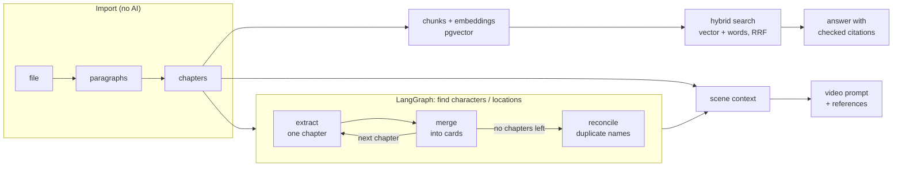

# Lorebook

Turn a book into chapters, characters, locations and scenes, and get ready-to-use prompts
and reference pictures for AI video. A working example of LangChain and LangGraph on a real
problem: FastAPI, PostgreSQL with pgvector, React.

Two kinds of projects:

- **Finished book.** Upload a text; it is read-only. You pick out characters, locations and
  scenes and prepare them for animation.
- **Writing a book.** Write and edit chapters in the app. One commit saves a version of the
  whole book and any version can be restored. Ask the book questions, get ideas for what
  happens next. The illustrator tools work here too.

## What it does

| | |
|---|---|
| Import | TXT, EPUB, FB2, DOCX, text PDF. Chapters are found without any AI; boundaries can be fixed by hand. |
| Characters and locations | Read chapter by chapter on request. Each card has permanent traits, a timeline by chapter (clothes, wounds, carried objects) and a quote for every fact. |
| Chat about the book | Answers only from the text, with citations that open the exact paragraph. Says so when the book does not answer. |
| Pictures | One visual style per project. Galleries per card, looks tied to chapter ranges, image prompts built from a card. |
| Scenes | Split a chapter into scenes or select text by hand. Video prompt, references picked for that chapter, an archive to take to a video service. |
| Writer mode | Autosaving editor, whole-book versions with rollback, stale markers on everything derived from changed text, plot suggestions. |
| Cost control | Nothing calls a model unless you press a button. Expensive runs show an estimate first. A usage journal per operation and model. |

## How it is built



Decisions worth knowing about:

- **Resumable analysis.** The LangGraph loop stores the model's raw answer per chapter, keyed
  by the hash of the chapter text and the prompt version. A run that fails halfway, or a
  later run over the same text, pays nothing for chapters already read. Turning stored
  answers into cards is deterministic, so cards can be rebuilt without a model call.
- **Staleness instead of magic.** Everything derived from text records the hash it was
  computed from. Edit a chapter and its cards and scenes are marked stale; nothing is
  recomputed until you ask, and then only for the chapters that changed.
- **Citations are verified.** A quote returned by the model is shown as a source only if it
  is found verbatim in the passage the model was given. Invented quotes are dropped.
- **Small-to-big retrieval.** The local embedding model reads about 128 tokens, so chunks are
  a few sentences. Each hit is returned with its neighbours. Vector similarity and query-word
  matches are fused by reciprocal rank, which is what finds a rare name the embedding model
  has never seen.
- **One door to the models.** `llm/registry.py` builds every chat model from a connection
  (any OpenAI-compatible endpoint, or the local Claude Code CLI). `llm/calls.py` wraps calls
  with JSON parsing, one repair attempt and the usage journal. Structured output goes through
  plain JSON because free models and the CLI do not support tool calling reliably.
- **The user's decisions outrank the model's.** Cards are read-only, with one exception:
  merging two cards or splitting a name into its own card. Later runs keep those decisions.

Layout: see [CLAUDE.md](CLAUDE.md).

## Run locally

Requires [uv](https://docs.astral.sh/uv/) and Node.js 22+. No database to install: with
`DATABASE_URL` empty, an embedded PostgreSQL with pgvector starts in `data/`.

```bash
cd frontend && npm install && npm run build && cd ..
cd backend && uv sync && uv run uvicorn app.main:app --port 8000
```

Open http://127.0.0.1:8000 and add a connection in Settings: an address and key of an
OpenAI-compatible API (Hubris has a preset). Or set `HUBRIS_API_KEY` in `.env` (or in the
container environment): the "Hubris" connection is then created at startup and only the
model is left to choose. The app talks to API providers only.

To try it without your own book, create a project from `demo/lighthouse.txt`.

The first question in the chat downloads the embedding model (about 220 MB) into `data/`.

For development run the API with `--reload` and `npm run dev` in `frontend/` (port 5173).

## Run with Docker

Create `.env` next to `docker-compose.yml`:

```ini
# Password of the database container. Letters and digits only: it goes into a URL.
POSTGRES_PASSWORD=
# Long random string. Encrypts stored API keys and signs sessions.
# python -c "import secrets; print(secrets.token_urlsafe(48))"
SECRET_KEY=
# The one password that opens the app.
APP_PASSWORD=
# Port on the host.
PORT=8000
```

```bash
docker compose up -d --build
```

The app has no user accounts. `APP_PASSWORD` is one shared password that keeps strangers
from spending your model credits; put the app behind HTTPS when it is reachable from the
internet. Set `HUBRIS_API_KEY` in the same `.env` to connect the model provider.

On a server, add `DOMAIN` to `.env` (a bare IP works through sslip.io:
`203-0-113-7.sslip.io`) and start with Caddy in front, which gets the certificate itself:

```bash
docker compose -f docker-compose.yml -f docker-compose.https.yml up -d --build
```

## Tests

```bash
cd backend && uv run pytest -q
```

The suite starts its own throwaway PostgreSQL, builds the schema with the migrations and
uses fake models and hash embeddings, so it needs no keys and no network.

## Status and limits

- Image generation (pictures of cards, first frames of scenes) is implemented for
  OpenAI-compatible endpoints and covered by tests against a mocked transport. It has not
  been run against a real provider yet.
- The Docker setup has not been run yet either; it was written on a machine without Docker.
- Video is not generated in the app: it produces the prompt and the references for an
  external service.
- Single user. No accounts, no sharing.
- Scanned PDFs (OCR) and import by URL are not supported.
- Name matching and stems are tuned for Russian, Belarusian and English.

## Schema changes

```bash
cd backend
uv run alembic revision --autogenerate -m "what changed"
```

Migrations are applied on startup.
